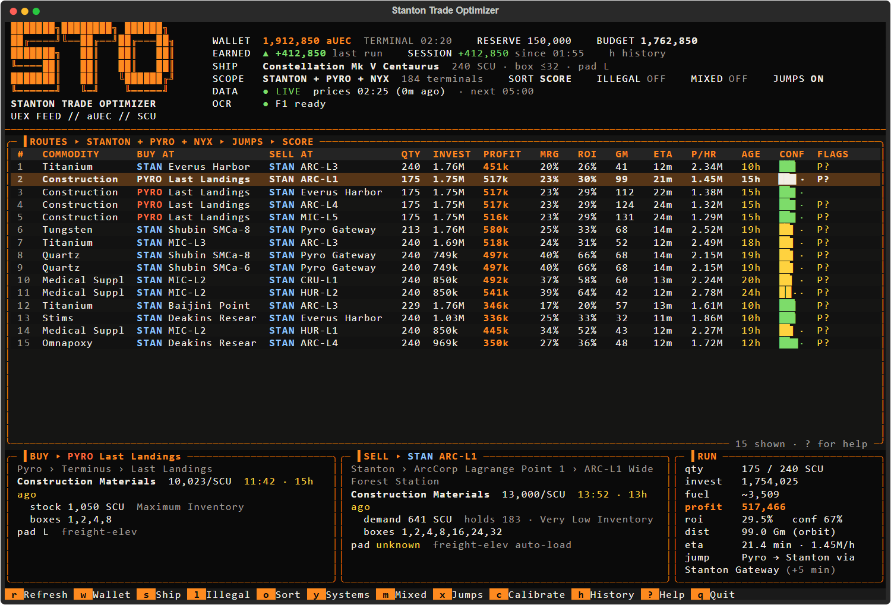

# Stanton Trade Optimizer

Shows you the most profitable cargo runs in Star Citizen right now, sized to the money in your wallet and the hold of the ship you fly.

- Prices come from [UEX](https://uexcorp.space), where players report terminal prices.
- The app refreshes them every few minutes.
- Press F1 in game to open the mobiGlas, and the app reads your balance off the screen by itself.



## What you need

- Windows 10 or 11.
- An internet connection.

That's all. If you don't have Python, setup installs it for you.

## Download

Get the zip from the [latest release](https://github.com/benefvctr/stanton-trade-optimizer/releases/latest): under **Assets**, click `Stanton-Trade-Optimizer-<version>.zip`. Don't use the green Code button; that's the source with its test files.

## Install

1. **Unblock the zip.** Right-click the zip, choose **Properties**, tick **Unblock** at the bottom and click **OK**. This stops Windows warning you about every file inside. If there's no Unblock box, skip this.
2. **Extract it** somewhere normal, like Documents or your Desktop. Don't run it from inside the zip, and don't put it in Program Files.
3. **Double-click `run.cmd`.**

The first time, setup runs in that window:
- **Python:** it looks for Python 3.12 or newer. If there is none, it asks before installing Python 3.13 from python.org. No admin rights needed; it installs for your Windows user only.
- **Packages:** it installs the app's packages into a private `.venv` folder next to the app. Nothing else on your PC is touched.
- **Shortcut:** it offers a desktop shortcut, which opens the app maximized.

It takes a minute or two. After that, `run.cmd` (or the shortcut) starts the app straight away.

If Windows shows "Windows protected your PC" or "The publisher could not be verified", click **More info** and **Run anyway** (or **Run**). That's normal for scripts downloaded from the internet. If setup ever stops halfway, run `setup.cmd` to try again.

## First time in the app

Make the window big. The app needs about 140 columns by 40 rows to show everything, so maximize it. In a smaller window it hides the logo and the detail pane, and the route table stays.

1. **Tell it your balance.** Pick one:
   - **Automatic (recommended).** Press `c`, then `A`. You get 5 seconds: switch to the game and press F1 to open the mobiGlas. The app finds your balance on screen, saves where it is, and shows the number it read. From then on, every time you press F1 in game, your balance updates in the app.
   - **By hand.** Press `w` and type it.
2. **Pick your ship.** Press `s`, then `A`, type part of the name (`cutlass`, `cat`, `hull c`) and press Enter. The default is a Constellation Mk V Centaurus (240 SCU).

That's it. The table now shows the best runs for your money and your hold.

## Terminal prices (automatic)

When you open a commodity terminal in game, the app reads its prices off the screen within a few seconds:
- **Buy list:** every visible row's price, stock and inventory level.
- **Your cargo:** with cargo selected, what this terminal pays for it.
- **Your balance:** shown at the top of the terminal, read as a bonus.

The routes that use these prices are marked **★** and count as fresh. They beat UEX's player reports, which are often days old, until UEX gets a newer report.

- **Which terminal:** the screen never names it, so the app works it out. It uses the location shown when one of your inventories is selected, otherwise the set of goods and their prices. If it can't tell, it saves nothing and says so on the TERMINAL status line.
- **Long lists:** only the rows on screen get read. Scroll a long list to read the rest.
- **What it needs:** stand so the whole terminal is in view. It only looks while Star Citizen is the focused window.

Turn it off with `enabled = false` under `[terminal]` in `config.toml`.

## Using it

| Key | What it does |
|---|---|
| `r` | refresh prices now |
| `w` | type your wallet balance |
| `s` | your ships: switch, add a new one, remove one |
| `y` | which system: Stanton, Pyro, Nyx, or all three |
| `o` | sort by: best bet (profit x confidence), raw profit, or profit per hour |
| `l` | include illegal goods or not |
| `m` | mixed cargo: fill leftover space with a second commodity on the same run |
| `c` | set up balance reading (OCR) |
| `?` | help |
| `q` | quit |

Arrow up and down through the table, and the panes at the bottom show the details of that run.

**Your money:** the app never spends a reserve, 150,000 aUEC by default, kept for fuel and repairs. It never suggests a run you can't afford.

### Reading the table

- **BUY AT / SELL AT:** where to buy, and where to sell.
- **QTY:** how many SCU to buy. Limited by your hold, your budget, the stock at the buy terminal, and how much the sell terminal will take (when known).
- **INVEST / PROFIT:** what you spend, and what you make after estimated fuel.
- **MRG / ROI:** profit per SCU as a share of the sell price, and profit as a share of what you spend.
- **GM / ETA:** distance in gigameters and the estimated time for the run, including about 8 minutes of landing and loading.
- **P/HR:** profit per hour at that ETA.
- **AGE:** how old the price reports are. Green is fresh, yellow is a day or two, red is old.
- **CONF:** how much to trust those prices. Full when fresh, half after a day, close to nothing after three days.

Flags at the end of a row:

| Flag | Meaning |
|---|---|
| `★` | uses prices you read at an in-game terminal yourself |
| `P?` | UEX doesn't know if your ship fits that landing pad (most terminals) |
| `B?` | container sizes at that terminal are unknown |
| `D?` | the sell terminal's demand is unknown, so the quantity isn't capped by it |
| `~` | distance is an estimate |
| `S` | stale: the prices are old, double-check at the terminal |

The default sort, "best bet", is profit times confidence. A huge profit based on week-old prices ranks below a solid one reported an hour ago.

## Ships

- **Switch, add or remove:** press `s`. Enter switches to a ship, `A` adds one, `Del` removes one.
- **The list:** `A` shows every cargo ship UEX knows, biggest hold first. Type to narrow it down and press Enter to add it. It becomes your active ship straight away.
- **Missing details:** if UEX doesn't know a ship's biggest box or pad size, you pick it from a short list.
- **Updates:** the ship list refreshes itself once a day. After a patch adds a ship, press **Ctrl+R** in the list to get it now.

For more accurate travel times, open `config.toml` in Notepad. Find your ship and change `qt_speed_gm_s`: the distance of one quantum jump in gigameters divided by the seconds it takes. The 0.2 default is a guess, because UEX has no drive speeds.

## Updating

Download the new zip from the [latest release](https://github.com/benefvctr/stanton-trade-optimizer/releases/latest), unblock it, and extract it over your old folder. Say yes to replacing files. Nothing is lost:
- your settings, calibration and ships (`config.toml`);
- saved prices (`cache`);
- installed packages (`.venv`).

The next `run.cmd` installs anything new by itself.

## Settings

Everything lives in `config.toml`, which the app creates the first time it runs. It opens in Notepad. Each setting has a comment explaining it. Useful ones:

- **Reserve:** `reserve`, the money the app never spends. Default 150,000.
- **Systems:** `systems`, which systems to include when the app starts.
- **Price refresh:** `price_refresh_s`, how often prices refresh. Default every 5 minutes.
- **Landing pads you know:** `[pad_overrides]`. Once you know a terminal takes your ship, add a line like `"ARC-L1" = "S,M,L"` and its `P?` goes away.

Close and reopen the app after editing.

## Optional extras

- **Tabby terminal.** If you use [Tabby](https://tabby.sh), setup can add a "Trade Terminal" profile to it. To add it later, run `.venv\Scripts\python.exe tools\install_tabby_profile.py` with Tabby closed.
- **UEX token.** Not needed: the prices are public. If UEX ever starts requiring one, create one on uexcorp.space under **My Apps**, then put it in a file named `.env` next to `run.cmd`:
  ```
  UEX_TOKEN=your-token-here
  ```

## Is it safe with Easy Anti-Cheat?

The app only does three things that involve the game, all of them from outside it:
- It listens for the F1 key, without blocking it, so the game still gets the key.
- After F1, it takes a screenshot of the small box around your balance.
- While Star Citizen is the focused window, it takes a screenshot of the game window every 3 seconds to spot a commodity terminal and read its prices. It finds out which window is focused from the window's title.

It never reads game memory, never sends keys or clicks to the game, and never touches the game's files or process. No administrator rights are needed while Star Citizen runs normally.

## Troubleshooting

| Problem | Fix |
|---|---|
| Setup says Python wasn't found after installing it | Close the window and run `setup.cmd` again |
| Setup can't install packages | Check your internet connection and run `setup.cmd` again |
| `c` then `A` says it can't find the mobiGlas | Press F1 within the 5 seconds and keep the mobiGlas on its home screen until the notification shows. Or take a screenshot with the mobiGlas open and use `c` then `F` instead |
| F1 stops updating the balance | Run `c` then `A` again, for example after changing resolution or monitor. Every read is logged in `logs\ocr.log` |
| Setup says Windows OCR has no language | Add English in Windows Settings > Time and language > Language and region, then restart the app. Until then, use `w` |
| Running the game as administrator | Then the F1 listener can't see keys. Run Star Citizen normally, or use `w` |
| No routes shown | Your wallet may be at or below the reserve. Press `w`, or lower `reserve` in `config.toml` |
| Terminal prices aren't read | Check the TERMINAL part of the status line. Stand so the whole terminal is on screen, with the game window focused. Every reading is logged in `logs\ocr.log` (lines starting with TERMINAL) |
| Something else breaks | The app keeps running and logs the error to `logs\app.log`. Send that file to whoever gave you the app |

## Known limits

- **Prices are player reports.** They can be hours or days old. Check the terminal before you buy.
- **Missing details.** Demand and landing-pad sizes are missing for most terminals in UEX's data. The flags show where.
- **Estimates.** Travel times and fuel costs are estimates, not game data.
- **One system per run.** Both ends of a run are in the same system. No multi-stop routes, contracts or in-game overlay.

## For tinkerers

Command line, from this folder:
- `run.cmd --refresh` fetches prices and prints the top runs without the UI.
- `run.cmd --test-ocr screenshot.png` reads the balance from a saved screenshot.
- `run.cmd --calibrate` sets up OCR from the command line.
- `run.cmd --add-ship "MISC Hull C"` adds a ship.

Files the app writes:
- `config.toml`: your settings. Delete it to go back to the defaults in `config.default.toml`.
- `cache\sto.sqlite`: saved UEX data. Delete it to start fresh.
- `logs\`: what the app logged.
- `.venv\`: the private Python environment. Delete it, then run `setup.cmd`, to reinstall.

The UEX fields the app reads are listed in `docs\API_FIELDS.md`.
